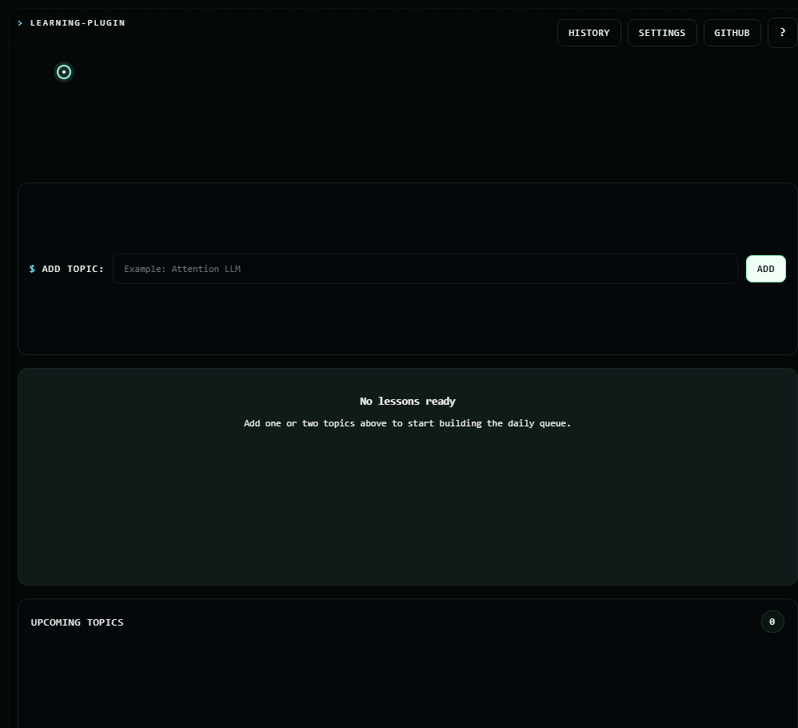

# `learning-plugin`

```text
> add topic
> generate 2 cards
> learn something technical
```

A compact WebExtensions MV3 learning tool with a terminal-style UI.



## `> overview`

```text
ui         React + TypeScript
runtime    WebExtensions MV3
build      Vite
providers  Ollama / Gemini / OpenAI
default    Ollama + qwen2.5:3b
```

- keeps a local topic queue
- orders topics with lightweight prerequisite logic
- shows 2 visible lesson cards at a time
- generates cards with a local or hosted LLM
- stores history, settings, and reminders locally

## `> quick start`

```bash
npm install
npm run typecheck
npm run test
npm run build
```

## `> load in chrome`

```text
1. run npm run build
2. open chrome://extensions or your browser's extensions page
3. enable Developer mode
4. click "Load unpacked"
5. choose builds/chrome/
```

## `> load in firefox`

```text
1. run npm run build:firefox
2. open about:debugging#/runtime/this-firefox
3. click "Load Temporary Add-on"
4. choose builds/firefox/manifest.json
```

## `> providers`

Build targets:

```bash
npm run build
npm run build:firefox
npm run build:all
```

Default local provider:

```powershell
ollama pull qwen2.5:3b
```

Useful checks:

```powershell
ollama list
ollama ps
```

Firefox fallback if the extension cannot connect to Ollama:

```powershell
$env:OLLAMA_ORIGINS="chrome-extension://*,moz-extension://*,safari-web-extension://*"
ollama serve
```
